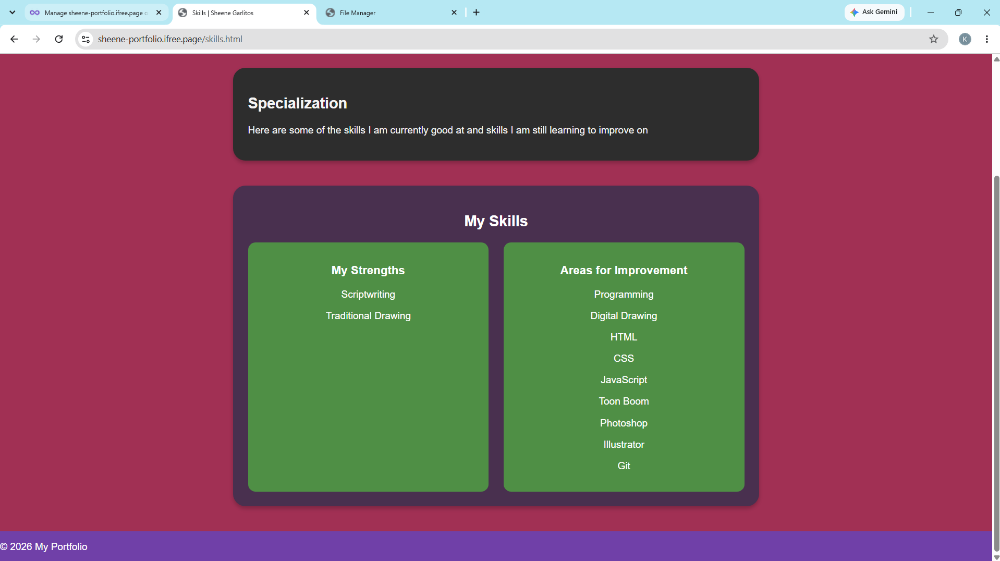
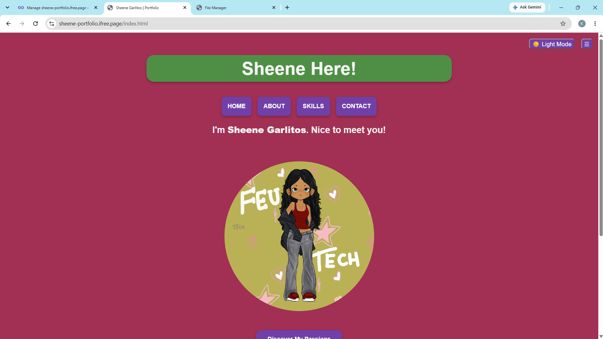
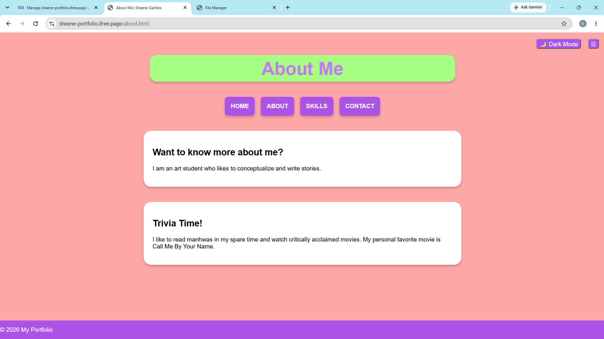

# Project Title
- Sheene Garlitos | Portfolio
## Overview
- The site is an attempt for a BMA student who is a novice in web designing to practice her skills. It is a practice portfolio, showcasing my skills as an artist.
## Features
- The features include a dark/light mode for the visitors to switch on based on their preferences. It has a hover function and buttons with navigation links to go to other pages of the site. Also there is a form that validates the fields however it does not send or save the information.
## Technologies
- HTML
- CSS
- JavaScript
- InfinityFree
- GitHub
- Visual Studio Code
## Setup
- You can access it by clicking the URL link below in the Live Demo
## Live Demo
- https://sheene-portfolio.ifree.page/
## Screenshots
### Dark Mode

### Light Mode

## Credits
- The images that I used were personally designed by me. They were digitally made using photoshop in order to subtly tell my audience that I have experience with working with Photoshop.
## AI Use
- I used AI or specifically Copilot and ChatGPT assisted me while figuring out how to do the buttons, hover, navigation links, and how to
include dark-mode and light-mode in my website for M3. I also used ChatGPT GPT-6 Luna in generating the hex code for my color palette that I desired to use for my website layout for M2 in the beginning when I was setting out to design my website. I used Microsoft Copilot Basic as my AI tool to audit my Local Storage implementation and suggest areas for verification for M6. I used Microsoft Copilot Basic as it influenced the planning of my JavaScript features, the review of my contact form validation, and the readability critique of my code. I tested the suggestions, applied only the changes I understood, and rejected suggestions I could not justify for M5. I used AI while fully disclosing I used it since it was required by my professor to fully acknowledge that this was an AI integrated assignment.

I can explain every line of this submission without assistance. — Kathleen Sheene Garlitos

