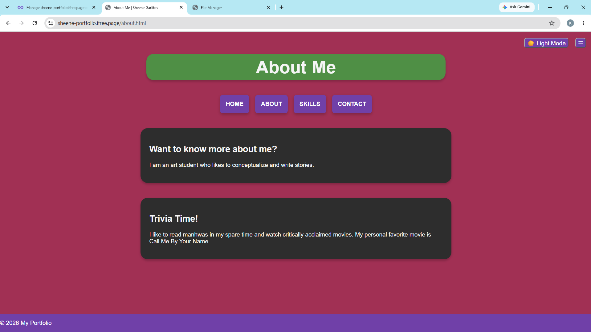
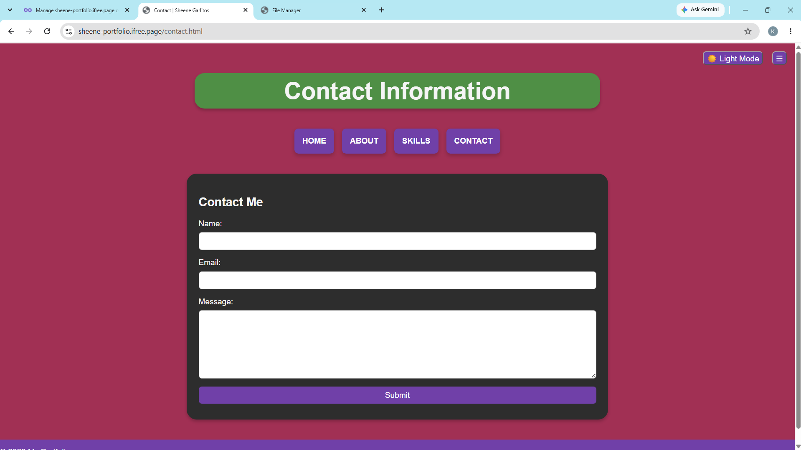
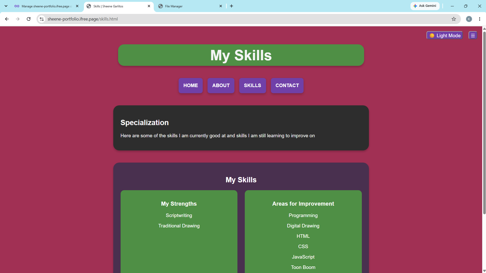
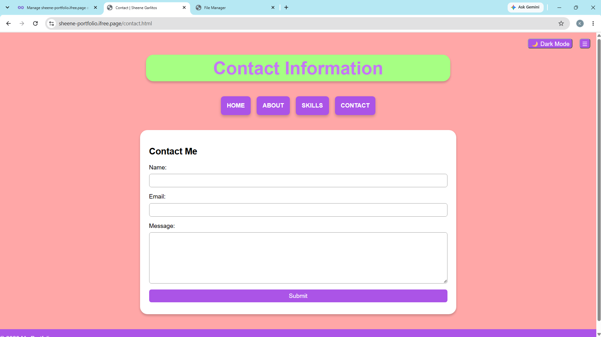
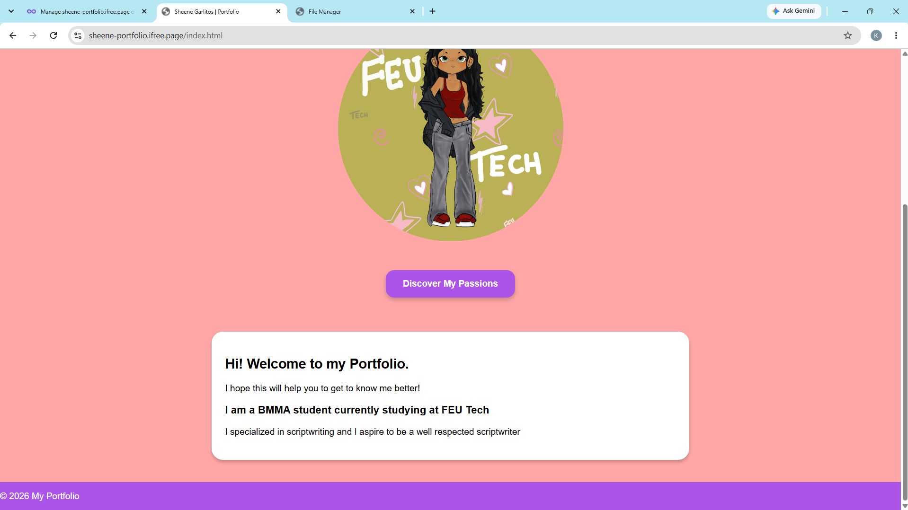
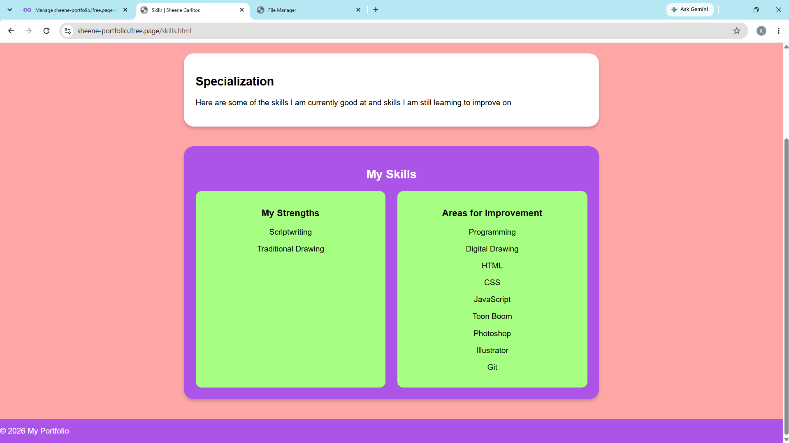
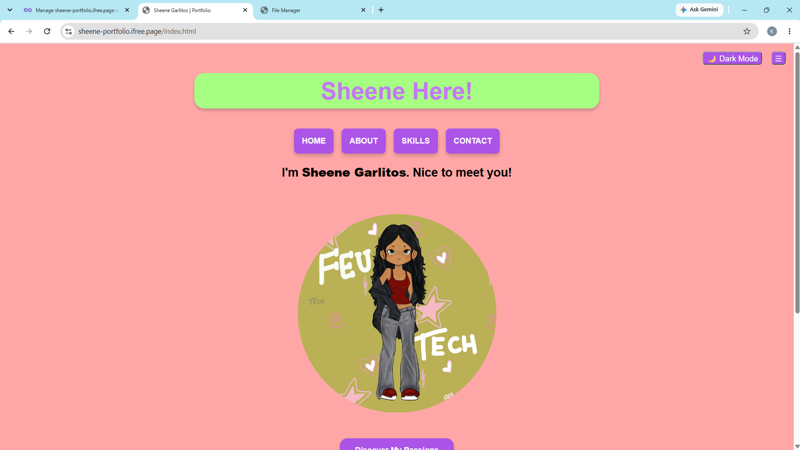
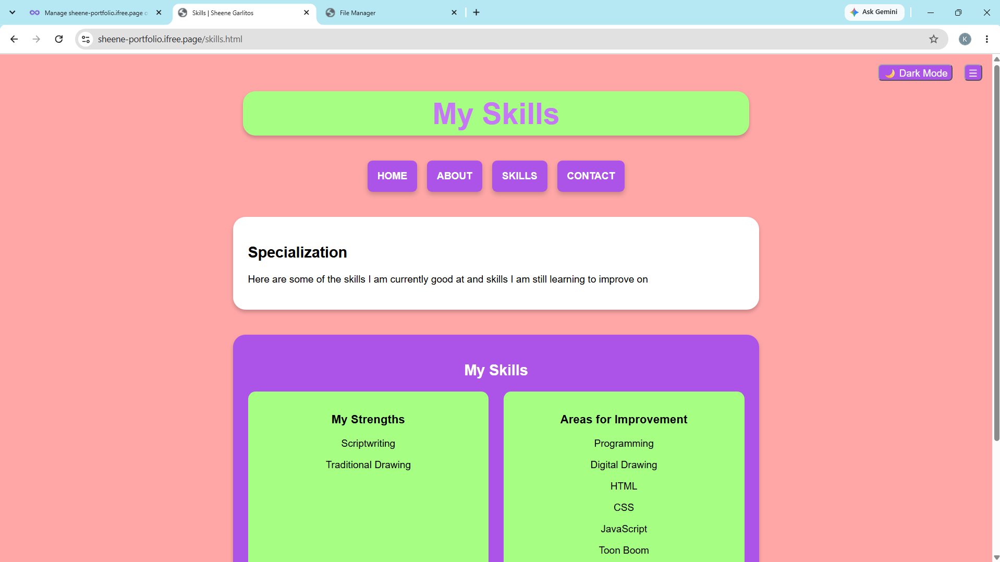

# Project Title
- Sheene Garlitos | Portfolio
## Overview
- The site is an attempt for a BMA student who is a novice in web designing to practice her skills. It is a practice portfolio, showcasing my skills as an artist.
## Features
- The features includes a dark/light mode for the visitors to switch on based on their preferences. It has a hover function and buttons with navigation links to go to ther pages of the site. Also there is a form that validates the fields however it does not send or save the information.
## Technologies
- HTML
- CSS
- JavaScript
- InfinityFree
- Github
- Visual Studio Code
## Setup
- You can access it by clicking the URL link below in the Live Demo
## Live Demo
- https://sheene-portfolio.ifree.page/
## Screenshots
### Dark Mode

### Light Mode

## Credits
- The images that I used were personally designed by me. They were digitally made using photoshop in order to subtly tell my audiences that I have experience with working with Photoshop.
## AI Use
- I used AI or specifically Copilot and Chatgpt to assit me when trying to figure out on how to do the buttons, hover, navigation links, and how to
include dark-mode and light-mode in my website. I also used AI in generating the hex code for my color palette that I desired to use for my website layout.